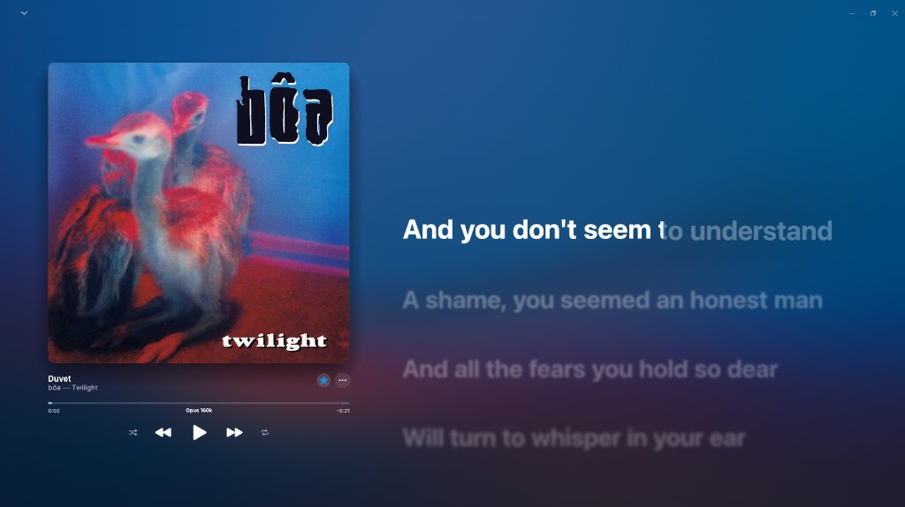
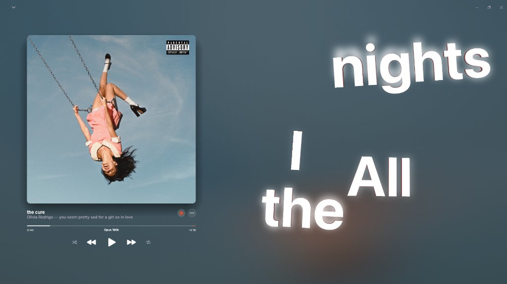
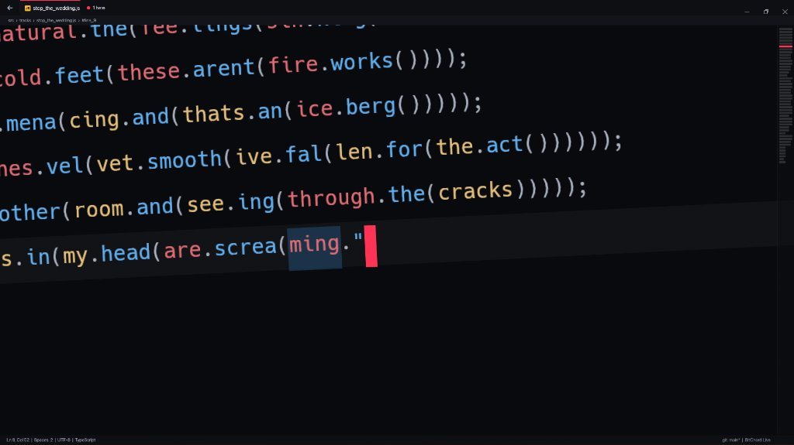
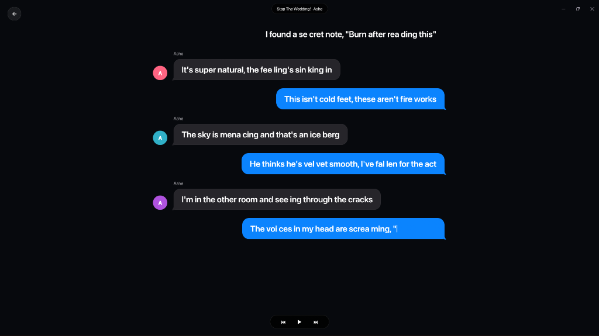
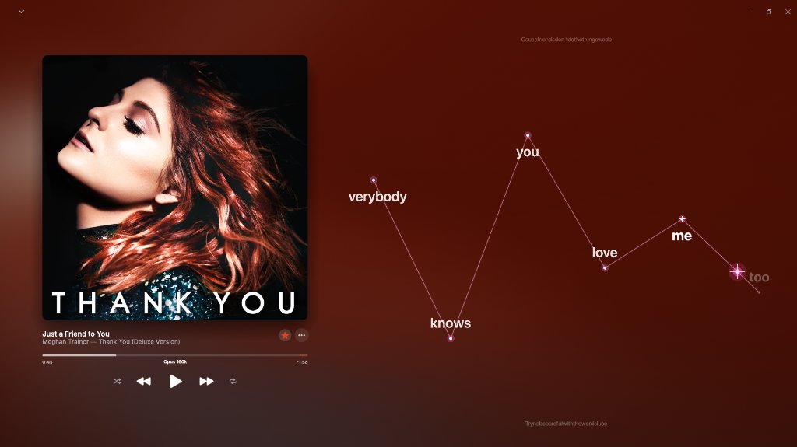
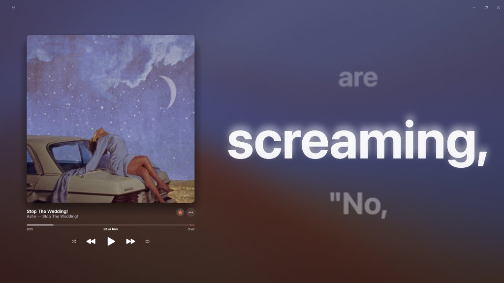

<div align="center">
  <h1>BitChord</h1>
  <p><strong>A fast, native YouTube Music & Universal Streaming desktop app — rebuilt in Rust with Liquid Glass UI.</strong></p>
  <p>No Electron, no embedded web player. Ultra-low latency, light memory footprint, and high-fidelity sound.</p>

  <p>
    <a href="https://github.com/danialgobel/BitChord/releases/latest"></a>
    
    <a href="LICENSE"></a>
  </p>

  <p>
    <a href="https://github.com/danialgobel/BitChord/releases/latest">Download Windows (.exe)</a> ·
    <a href="#features">Features</a> ·
    <a href="#lyrics-modes">Lyrics Modes</a> ·
    <a href="#comparison">Original vs Developed</a> ·
    <a href="#platform-status">Platform Status</a> ·
    <a href="#installation">Installation</a> ·
    <a href="#building-from-source">Build from Source</a>
  </p>
</div>

> [!NOTE]
> **Project Origin & Attribution**: BitChord was originally conceptualized and created by [kushagrasinghx](https://github.com/kushagrasinghx/BitChord) (with foundation work from [grapedjuice/ytm-rs](https://github.com/grapedjuice/ytm-rs)). This repository is an advanced, standalone desktop fork developed by [Danial Gobel](https://github.com/danialgobel), re-engineered in native Rust (`egui` + `rodio`) with universal playlist import capabilities, an Apple-inspired liquid glass interface, kinetic lyrics, and Windows standalone packaging.

---

## Platform Status

| Platform | Version | Status | Distribution |
|---|---|---|---|
| **Windows (x64)** | `v2.0.1` | **Stable (Available)** | [Download Setup (.exe)](https://github.com/danialgobel/BitChord/releases/latest) · [Portable (.zip)](https://github.com/danialgobel/BitChord/releases/latest) |
| **Android** | `v2.0.0-dev` | **In Development** | *Coming Soon (APK under testing)* |
| **Linux** | `v2.0.1` | *Source Available* | Build from source with Cargo |
| **macOS** | `v2.0.1` | *Source Available* | Build from source with Cargo |

---

## Comparison: Original vs Developed Version

| Aspect | Original (`kushagrasinghx/BitChord`) | Developed Version (`danialgobel/BitChord` v2.0.1) |
|---|---|---|
| **Primary Platform** | Android mobile application (Kotlin / Jetpack Compose). | Native High-Performance Desktop Client (Rust / `egui` / `rodio`). |
| **User Interface** | Material 3 / Android mobile layout. | Apple-inspired Liquid Frosted Glass UI, rounded capsule controls, and dynamic palette tinting. |
| **Audio Engine** | Android Media3 / ExoPlayer & USB DAC bit-perfect. | Native Symphonia/rodio audio pipeline with integrated Local Hi-Res Streamer and volume curves. |
| **Playlist Import** | Spotify account transfer only. | **Universal Playlist Importer**: One-click import from Apple Music (instant SSR parser), YouTube, Spotify, and Deezer via local addon server. |
| **Lyrics Experience** | Synced lyrics via multiple providers. | **Cinematic Lyrics Engine**: Kinetic word-by-word animation, convex lens 3-word roller, code-editor style, and chat-bubble mode. |
| **In-App Updater** | Standard mobile update checker. | **Floating Glass Notification Pill**: Top-center spring physics animation, bilingual (EN/ID), restart action, and author attribution. |
| **Windows Packaging**| None (Android APK only). | Enterprise **Inno Setup 6 Installer** (with auto WebView2 detection) + Zero-install **Portable ZIP**. |
| **Local Service** | None. | Bundled companion **BitChord Addon Server** for fast headless parsing and local lossless playback. |

---

## Screenshots

<table>
  <tr>
    <td width="50%"></td>
    <td width="50%"></td>
  </tr>
  <tr>
    <td align="center"><b>Player</b> — artwork, cinematic kinetic lyrics, queue and playback in one view</td>
    <td align="center"><b>Browse</b> — your music, shelves, explore, and navigation</td>
  </tr>
  <tr>
    <td colspan="2"></td>
  </tr>
  <tr>
    <td colspan="2" align="center"><b>Desktop experience</b> — native Rust UI, liquid glass styling, fast playback, and quality controls</td>
  </tr>
</table>

---

<h2 id="lyrics-modes">🎤 Cinematic & Dynamic Lyrics Modes</h2>

BitChord elevates music listening with an industry-first collection of dynamic lyrics animation modes, rendered natively at uncapped frame rates:

<table>
  <tr>
    <td width="50%"></td>
    <td width="50%"></td>
  </tr>
  <tr>
    <td align="center"><b>Apple Kinetic Pop</b> — Real-time word-by-word spring highlights with ambient glow and dynamic background defocus</td>
    <td align="center"><b>Focus Word Roller</b> — Multi-word optical roller with glowing active typography and kinetic vertical glide</td>
  </tr>
  <tr>
    <td width="50%"></td>
    <td width="50%"></td>
  </tr>
  <tr>
    <td align="center"><b>IDE Code Editor</b> — Programmer aesthetic with line numbers, syntax-highlighted function chaining, and active cursor</td>
    <td align="center"><b>iMessage Chat Bubbles</b> — Interactive conversational bubbles with artist avatars and realistic balloon physics</td>
  </tr>
  <tr>
    <td width="50%"></td>
    <td width="50%"></td>
  </tr>
  <tr>
    <td align="center"><b>Melodic Constellation</b> — Star-chart waveform tracking lyric pitch changes across glowing celestial nodes</td>
    <td align="center"><b>Giant Kinetic Focus</b> — High-impact typography with bold scaling and soft radiant halo</td>
  </tr>
</table>

---

## Features

### Playback & Streaming
- **YouTube Music, natively** — search, browse, albums, playlists, artist pages, radio, mixes, charts, and your library.
- **Universal Playlist Import** — import any playlist link from Apple Music, Spotify, Deezer, and YouTube directly into your library without manual track searching.
- **Lossless / Hi-Res Local Audio** — bridge your local lossless music directory (`D:\Music` or `~/Music`) seamlessly into BitChord via the built-in Addon Server.
- **Quality controls** — see active audio quality and bitrate directly in the player.
- **Automix & Crossfade** — smooth transitions between songs.
- **Queue & Playback Controls** — shuffle, repeat, autoplay, song radio, next-track prefetch, and volume normalization.
- **Downloads** — save songs for offline playback.

### Interface & Lyrics
- **Cinematic Lyrics Engine** — timed lyrics with word-by-word highlighting, convex lens 3-word roller, code editor mode, and chat-bubble style.
- **Liquid Glass Aesthetic** — Apple-inspired frosted acrylic translucency, rounded pill styling, and dynamic album art color bleeding.
- **Floating Glass Update Pill** — smooth, unobtrusive top-center notification for new releases with one-click restart.
- **Discord Rich Presence** — share your current track and artist on Discord.
- **Last.fm Scrobbling** — scrobble tracks automatically.

---

## Installation

Download the latest version from [Releases](https://github.com/danialgobel/BitChord/releases/latest).

### Windows
1. **Setup Installer** (`BitChord-Setup-2.0.1.exe`):
   - Run the installer. It will automatically check for WebView2 and set up start menu shortcuts.
   - If Windows SmartScreen appears for a newly published release, click **More info → Run anyway**.
2. **Portable ZIP** (`BitChord-Portable-2.0.1.zip`):
   - Extract the ZIP archive anywhere on your PC and double-click `BitChord.exe`. No installation required.

---

## Building from Source

### Prerequisites
1. [Rust toolchain](https://rustup.rs/) (edition 2024 / stable).
2. [Python 3.10+](https://www.python.org/) (for the companion addon server).
3. Windows 10/11 with WebView2 Runtime (preinstalled on modern Windows).

### Build Steps
```sh
# Clone the repository
git clone https://github.com/danialgobel/BitChord.git
cd BitChord

# Build release executable
cargo build --release
```
The compiled binary will be located in `target/release/bitchord.exe`.

---

## Contributing

Contributions, bug reports, and suggestions are welcome! Please open an issue or pull request on GitHub with detailed reproduction steps.

---

## License & Acknowledgements

- **License**: Licensed under [GNU General Public License v3.0 (GPL-3.0)](LICENSE).
- **Original Concept**: [kushagrasinghx](https://github.com/kushagrasinghx/BitChord) & [grapedjuice/ytm-rs](https://github.com/grapedjuice/ytm-rs).
- **Desktop Evolution**: [Danial Gobel](https://github.com/danialgobel).
- **Libraries**: [egui](https://github.com/emilk/egui), [rodio](https://github.com/RustAudio/rodio), and Symphonia.

---
*Disclaimer: BitChord is an independent, unofficial client. It is not affiliated with, endorsed by, or connected to Google, YouTube, Spotify, or Apple.*
